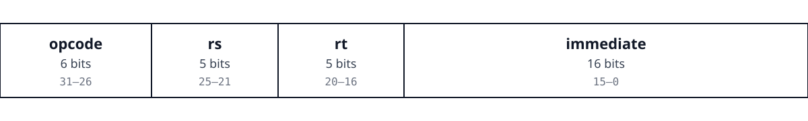
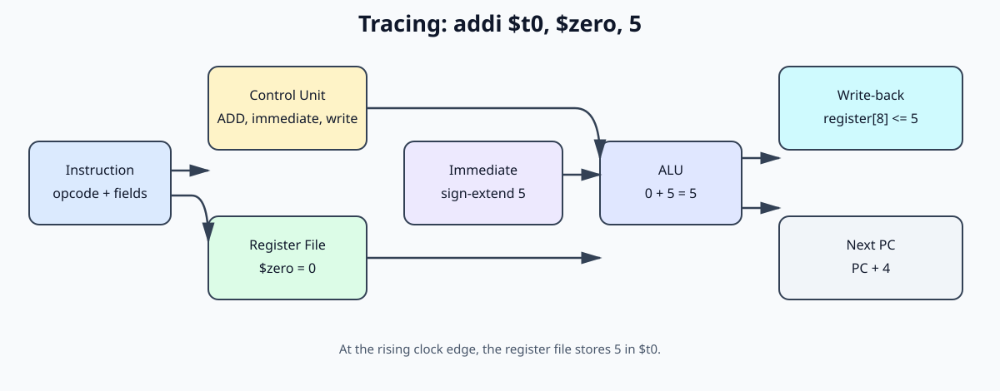

# MIPS32 Single-Cycle Processor in Verilog

> A visual, beginner-friendly journey from basic Verilog modules to a
> working CPU.

You will build a small MIPS32-style single-cycle processor in Verilog. This
README is for you if you can read simple Verilog, such as an ALU, but are still
learning what a CPU, an instruction set, registers, memory, and a datapath
actually are.

You do **not** need previous knowledge of:

- MIPS or RISC-V assembly;
- CPU architecture;
- instruction encoding;
- pipelining;
- operating systems;
- FPGA or ASIC design.

You will use an intentionally educational design. You can read the small RTL
modules, run the testbenches to see how each block behaves, and connect the
textbook concepts to the actual files in `rtl/`.

---

## Table of contents

1. [Start here](#start-here)
2. [The big idea: what a CPU does](#the-big-idea-what-a-cpu-does)
3. [What does single-cycle mean?](#what-does-single-cycle-mean)
4. [The processor at a glance](#the-processor-at-a-glance)
5. [How one instruction travels](#how-one-instruction-travels)
6. [The repository as a book](#the-repository-as-a-book)
7. [The beginner learning path](#the-beginner-learning-path)
8. [The instruction formats](#the-instruction-formats)
9. [A complete `addi` walkthrough](#a-complete-addi-walkthrough)
10. [Loads, stores, branches, and jumps](#loads-stores-branches-and-jumps)
11. [Current instruction subset](#current-instruction-subset)
12. [Repository structure](#repository-structure)
13. [Run the processor](#run-the-processor)
14. [Understand the testbenches](#understand-the-testbenches)
15. [What this project does not cover](#what-this-project-does-not-cover)
16. [Further reading](#further-reading)

---

## Start here

If you are completely new to CPUs, follow this order:

1. Read the short explanation in [The big idea](#the-big-idea-what-a-cpu-does).
2. Look at the [CPU overview](#the-processor-at-a-glance).
3. Read `rtl/alu.v` and run `tb/alu_tb.v`.
4. Learn state with `rtl/pc.v` and `rtl/register_file.v`.
5. Read the [beginner learning path](docs/beginner-roadmap.md).
6. Run the complete CPU simulation.
7. Read the [architecture chapter](docs/architecture.md) while following the
   wires in `rtl/datapath.v`.

Do not try to memorize every control signal on the first reading. Your goal is to understand the journey of one instruction. Once that journey
is clear, you will recognize the individual Verilog signals much more easily.

---

## The big idea: what a CPU does

You can think of a CPU as repeatedly performing this simple loop:

```text
1. Find the next instruction.
2. Understand what the instruction says.
3. Read the values it needs.
4. Calculate a result or an address.
5. Read or write memory if required.
6. Save the result.
7. Decide where to find the next instruction.
```

For example, an instruction might say:

```text
addi $t0, $zero, 5
```

In plain English:

> Take the value in `$zero`, add 5, and store the result in `$t0`.

You can see the CPU perform that sentence using hardware:

```text
instruction bits
      ↓
control unit interprets them
      ↓
register file supplies $zero
      ↓
ALU adds 0 and 5
      ↓
register file stores 5 in $t0
```

Remember that the ALU is only one part of the CPU. You also need storage,
instruction interpretation, memory, and connections between those blocks.

---

## What does single-cycle mean?

Here, you complete one instruction during one clock period. You do not use
separate fetch, decode, execute, and write-back cycles; those activities happen
as one combinational path between clock edges.


Keep this distinction in mind:

| Combinational work | Clocked state |
| --- | --- |
| ALU result | Program counter |
| Control signals | Register-file writes |
| Immediate extension | Data-memory writes |
| Next-PC selection | |

At a rising edge, the processor remembers the new PC, register values, and
memory values. During the rest of the cycle, combinational logic calculates
what should happen next.

You can understand this design easily because each instruction has a complete
visible path. Although it is not the fastest CPU architecture, it gives you an
excellent first CPU architecture.

---

## The processor at a glance

You will find the top-level module in `rtl/mips32_cpu.v`. Use it to wire together
the PC, instruction memory, control unit, datapath, and data memory.


When you read the diagram, the large boxes correspond to real RTL modules:

| Concept | Repository file | Responsibility |
| --- | --- | --- |
| Program counter | `rtl/pc.v` | Remembers the current instruction address |
| Instruction memory | `rtl/instruction_memory.v` | Returns the instruction at the PC |
| Control unit | `rtl/control_unit.v` | Interprets opcode and function fields |
| Register file | `rtl/register_file.v` | Stores 32 general-purpose registers |
| ALU | `rtl/alu.v` | Performs arithmetic and logical operations |
| Datapath | `rtl/datapath.v` | Connects operands, results, memory, and PC choices |
| Data memory | `rtl/data_memory.v` | Stores and returns program data |
| Complete CPU | `rtl/mips32_cpu.v` | Instantiates and wires everything together |

Think of the datapath as the road system of your processor. Values travel
along wires, and multiplexers choose which road each value takes.

---

## How one instruction travels

Every supported instruction follows the same broad story:

### 1. Fetch

You supply a byte address through the PC, and instruction memory uses that
address to return a 32-bit instruction.

Normal sequential execution advances by four bytes:

```text
next PC = current PC + 4
```

Instructions are four bytes wide, so the low two address bits must be zero.

### 2. Decode

You read the instruction's opcode in the control unit and, for R-type
instructions, its function field. You produce signals such as:

- should the ALU use a register or an immediate?
- should the result be written to `rd` or `rt`?
- should data memory be read or written?
- is this a branch or jump?
- which ALU operation is required?

### 3. Read operands

You read two registers at the same time through the register file. You also
form a 32-bit immediate from the instruction's 16-bit field in the datapath.

Different instructions use different immediate rules:

- arithmetic offsets are sign-extended;
- logical immediates are zero-extended;
- `lui` moves the value into the upper 16 bits;
- branch offsets are shifted left by two.

### 4. Execute

You perform the operation in the ALU. For a memory instruction, you calculate
an effective address:

```text
effective address = base register + offset
```

For a branch, subtraction produces the `zero` flag used to decide equality.

### 5. Memory

`lw` reads data memory. `sw` writes data memory. Other instructions do not
access data memory.

### 6. Write back

You can select the result from:

- the ALU;
- data memory;
- `PC + 4` for `jal`.

You can write the result to `rd`, `rt`, or register 31 (`$ra`).

### 7. Select the next PC

You choose the next PC in the datapath from:

```text
PC + 4
branch target
jump target
register target for jr
```

Use this priority: `jr`, then `j`/`jal`, then a taken branch, and finally the
normal sequential address.

---

## The repository as a book

You can study the project as a sequence of chapters. Each chapter has three
parts:

1. a hardware idea;
2. an RTL module;
3. an executable testbench.

| Chapter | Read | Then run |
| --- | --- | --- |
| 1. Combinational logic | `rtl/alu.v` | `tb/alu_tb.v` |
| 2. Clocked state | `rtl/pc.v` | `tb/pc_tb.v` |
| 3. Register storage | `rtl/register_file.v` | `tb/register_file_tb.v` |
| 4. Program storage | `rtl/instruction_memory.v` | `tb/instruction_memory_tb.v` |
| 5. Instruction interpretation | `rtl/control_unit.v` | `tb/control_unit_tb.v` |
| 6. Data storage | `rtl/data_memory.v` | `tb/data_memory_tb.v` |
| 7. Connecting the datapath | `rtl/datapath.v` | `tb/datapath_tb.v` |
| 8. The complete machine | `rtl/mips32_cpu.v` | `tb/mips32_cpu_tb.v` |

You can follow the full beginner course in
[`docs/beginner-roadmap.md`](docs/beginner-roadmap.md). You can follow the same
sequence in lesson form and complete its exercises.

---

## The beginner learning path

### Chapter 1: Begin with the ALU

Start with a circuit you already understand. You give the ALU two 32-bit
values and an operation code, and it produces a result and a zero flag.

```verilog
result = a + b;
```

At this stage, you have no memory and no instruction decoding. The ALU only
reacts to its inputs, which gives you an example of combinational logic.

Questions to answer:

- What changes when `a` changes?
- Why does the ALU not need a clock?
- How is signed `slt` different from bitwise operations?
- Why is the zero flag useful for branches?

### Chapter 2: Add time with the PC

Your PC is a 32-bit register. Unlike the ALU, it remembers a value across
clock edges:

```verilog
always @(posedge clk) begin
    pc <= next_pc;
end
```

Reset gives you a known starting address.

### Chapter 3: Add registers

Your register file contains 32 registers. You use a five-bit address to select
one:

```text
2^5 = 32
```

You get two asynchronous read ports and one synchronous write port. `$zero`
is hard-wired to zero, which gives you a common and useful CPU convention.

### Chapter 4: Store instructions

You map addresses to 32-bit instruction words through instruction memory. In
simulation, you can initialize the memory with `$readmemh` or directly from a
testbench.

At this point, you can see how a bit pattern becomes an instruction.

### Chapter 5: Decode instructions

You can treat the control unit as an interpreter implemented as combinational
RTL. You map instruction fields to control signals, while default controls keep
unsupported instructions safe and inert.

### Chapter 6: Store data

You keep data memory separate from instruction memory. A store changes memory
at a clock edge, while a read returns data combinationally.

### Chapter 7: Connect the datapath

You will combine the register file, immediate formation, ALU, write-back muxes,
branch logic, and jump logic in the datapath.

### Chapter 8: Build the complete CPU

When you connect the pieces in the top-level CPU, you can execute a small
program. At that point, you have a machine that changes state according to
instructions rather than a collection of isolated modules.

---

## The instruction formats

You will work with three simple instruction shapes.

### R-type: register operations


Example:

```text
add $t2, $t0, $t1
```

You read `$t0` and `$t1`, add them, and write the result to `$t2`.

### I-type: immediate and memory operations



Example:

```text
addi $t0, $zero, 5
```

You read `$zero`, form the immediate value 5, and write the result to `$t0`.

### J-type: control-flow operations


`j` and `jal` use the target field to construct a new PC.

More complete encoding tables are in
[`docs/instruction-set.md`](docs/instruction-set.md).

---

## A complete `addi` walkthrough

You will trace:

```text
addi $t0, $zero, 5
```

### Instruction bits arrive

You receive a 32-bit value from instruction memory, and the control unit
sees the opcode for `addi`.

### The control unit decides

Use these conceptual control settings:

```text
alu_src   = 1       // use the immediate as ALU input B
reg_dst   = 0       // destination is rt
reg_write = 1       // write a register
alu_op    = ADD
```

No memory access and no branch are enabled.

### The register file reads `$zero`

You always receive zero when you read register 0:

```text
register_data1 = 0
```

### The immediate is extended

You extend the 16-bit value 5 to:

```text
0x00000005
```

### The ALU calculates

```text
0 + 5 = 5
```

### The destination is selected

For an I-type instruction, the destination is `rt`. In this encoding, `rt`
is register 8, conventionally named `$t0`.

### The clock edge saves the result

At the rising edge:

```text
register[8] <= 5
```

You set the next PC to `PC + 4`.



Use this as your most important walkthrough. Every other instruction varies
which values you select, which operation you perform, and which state you
update.

---

## Loads, stores, branches, and jumps

### `lw`: load a word

```text
lw $t0, 4($t1)
```

1. Read `$t1`.
2. Sign-extend 4.
3. Add them in the ALU.
4. Read data memory at the resulting address.
5. Write the memory value into `$t0`.

### `sw`: store a word

```text
sw $t0, 4($t1)
```

1. Read `$t1` as the base.
2. Sign-extend 4.
3. Add them in the ALU.
4. Send `$t0` as memory write data.
5. Store it at the clock edge.

### `beq`: branch if equal

```text
beq $t0, $t1, offset
```

You subtract the operands in the ALU. If the result is zero, you use this
target:

```text
PC + 4 + (sign_extended_offset << 2)
```

You shift by two to convert an instruction offset into a byte offset.

### `bne`: branch if not equal

For `bne`, you use the same subtraction but take the branch when the ALU zero
flag is false. The explicit `branch_ne` signal tells your datapath to invert
the condition.

### `j`: jump

`j` builds a target from the instruction's 26-bit field and the upper four
bits of `PC + 4`.

### `jal` and `jr`: call and return

`jal`:

```text
$ra = PC + 4
PC  = jump target
```

With `jr $ra`, you read register 31 and use it as the next PC. You can see this
complete call-and-return path in the integration testbench.

---

## Current instruction subset

| Class | Instructions |
| --- | --- |
| R-type | `add`, `sub`, `and`, `or`, `xor`, `slt`, `sll`, `jr` |
| I-type | `addi`, `andi`, `ori`, `xori`, `lui`, `slti`, `lw`, `sw`, `beq`, `bne` |
| J-type | `j`, `jal` |

Use these implementation conventions:

- register 0 (`$zero`) always reads as zero;
- register 31 (`$ra`) stores the return address for `jal`;
- instruction and data addresses must be word-aligned;
- invalid memory addresses read as zero and ignore writes;
- reset is synchronous and active high;
- unsupported instructions safely advance the PC without changing state.

---

## Repository structure

<details>
<summary><strong>rtl/ — Processor implementation</strong></summary>

| File | Purpose |
|---|---|
| `alu.v` | Arithmetic and logic operations |
| `control_unit.v` | Opcode and function decoding |
| `data_memory.v` | Data memory |
| `datapath.v` | Datapath connections |
| `instruction_memory.v` | Instruction storage |
| `mips32_cpu.v` | Complete CPU |
| `pc.v` | Program counter |
| `register_file.v` | Register storage |

</details>

<details>
<summary><strong>tb/ — Testbenches</strong></summary>

| File | Purpose |
|---|---|
| `alu_tb.v` | ALU tests |
| `control_unit_tb.v` | Control-unit tests |
| `data_memory_tb.v` | Data-memory tests |
| `datapath_tb.v` | Datapath tests |
| `instruction_memory_tb.v` | Instruction-memory tests |
| `mips32_cpu_tb.v` | Complete CPU integration test |
| `pc_tb.v` | Program-counter tests |
| `register_file_tb.v` | Register-file tests |

</details>

<details>
<summary><strong>docs/ — Documentation and diagrams</strong></summary>

| File or directory | Purpose |
|---|---|
| `beginner-roadmap.md` | Beginner learning path |
| `architecture.md` | Datapath and control explanation |
| `instruction-set.md` | Instruction formats and encodings |
| `verification.md` | Testbench and CI strategy |
| `learning-notes.md` | Design notes and experiments |
| `diagrams/` | SVG diagrams and Mermaid sources |

</details>

---

## Run the processor

### Requirements

Install Git and at least one Verilog simulator. Icarus Verilog is the
simplest option for beginners; Verilator is a faster compiled simulator and
also provides useful lint checks.

Ubuntu/Debian:

```sh
sudo apt-get update
sudo apt-get install -y iverilog verilator
```

### Run the complete CPU test

From the repository root:

```sh
iverilog -g2012 -o cpu_sim \
  tb/mips32_cpu_tb.v \
  rtl/mips32_cpu.v \
  rtl/pc.v \
  rtl/instruction_memory.v \
  rtl/data_memory.v \
  rtl/datapath.v \
  rtl/control_unit.v \
  rtl/register_file.v \
  rtl/alu.v

vvp cpu_sim
```

You load a small program into instruction memory and verify register results,
memory behavior, branches, jumps, `jal`, `jr`, and PC sequencing with the
testbench.

### Alternative: run the complete CPU with Verilator

You can compile the Verilog into a native executable with Verilator. You need
the `--timing` option because the testbench contains clock delays and waits
such as `always #5 clk = ~clk` and `@(posedge clk)`.

From the repository root:

```sh
verilator --binary --timing \
  --top-module mips32_cpu_tb \
  tb/mips32_cpu_tb.v \
  rtl/mips32_cpu.v \
  rtl/pc.v \
  rtl/instruction_memory.v \
  rtl/data_memory.v \
  rtl/datapath.v \
  rtl/control_unit.v \
  rtl/register_file.v \
  rtl/alu.v

./obj_dir/Vmips32_cpu_tb
```

You should see the same `PASS` checks as the Icarus simulation, ending with:

```text
PASS: CPU integration test completed with no failures
```

Verilator is an additional method, not a replacement for understanding the
RTL. Icarus remains useful for simple, traditional Verilog simulation, while
Verilator is useful for fast execution and lint-style feedback.

### Generate a waveform for GTKWave

GTKWave needs a waveform file such as VCD or FST. Add these lines near the
beginning of the `initial` block in `tb/mips32_cpu_tb.v`:

```verilog
$dumpfile("cpu.vcd");
$dumpvars(0, mips32_cpu_tb);
```

Then compile with Verilator tracing enabled:

```sh
verilator --binary --timing --trace \
  --top-module mips32_cpu_tb \
  tb/mips32_cpu_tb.v \
  rtl/mips32_cpu.v \
  rtl/pc.v \
  rtl/instruction_memory.v \
  rtl/data_memory.v \
  rtl/datapath.v \
  rtl/control_unit.v \
  rtl/register_file.v \
  rtl/alu.v

./obj_dir/Vmips32_cpu_tb
gtkwave cpu.vcd
```

You can inspect signals over time in the waveform, including `clk`, `reset`,
`pc`, `instruction`, `next_pc`, memory controls, and datapath results. You can
use the same `$dumpfile` and `$dumpvars` lines with the Icarus command.

### Run an individual unit test

For the ALU:

```sh
iverilog -g2012 -o alu_sim tb/alu_tb.v rtl/alu.v
vvp alu_sim
```

You can run the other unit tests with the same compile-and-run pattern. CI runs
all eight testbenches on pushes, pull requests, and manual workflow dispatches.

---

## Understand the testbenches

Verification is layered:

| Level | What it proves |
| --- | --- |
| ALU test | Operations and zero flag |
| Register-file test | Reads, writes, reset, and `$zero` |
| Control-unit test | Decoding and safe defaults |
| PC test | Reset and next-PC loading |
| Instruction-memory test | Alignment, bounds, and reads |
| Data-memory test | Reads, writes, reset, alignment, and bounds |
| Datapath test | Muxes, write-back, branches, jumps, and memory interface |
| CPU test | Complete program execution |

Each testbench is an executable specification. Read the test before the RTL
when a module feels unfamiliar: the checks explain what behavior the module
promises.

More detail is available in [`docs/verification.md`](docs/verification.md).

---

## What this project does not cover

You are working with an intentionally small processor. You do not yet have:

- pipelining;
- forwarding or hazard detection;
- caches;
- exceptions and interrupts;
- privileged modes or operating systems;
- coprocessors;
- branch delay slots;
- arithmetic overflow exceptions;
- a real memory bus or memory controller;
- synthesis-specific timing constraints.

You do not need these features to understand this repository. They are the
next chapters you can study after you become familiar with the single-cycle
design.

---

## Further reading

- [Beginner roadmap](docs/beginner-roadmap.md)
- [Architecture and datapath](docs/architecture.md)
- [Instruction set and encodings](docs/instruction-set.md)
- [Verification and CI](docs/verification.md)
- [Learning notes and experiments](docs/learning-notes.md)
- [Visual diagrams and editable Mermaid sources](docs/diagrams/README.md)

## License

See [`LICENSE`](LICENSE).
