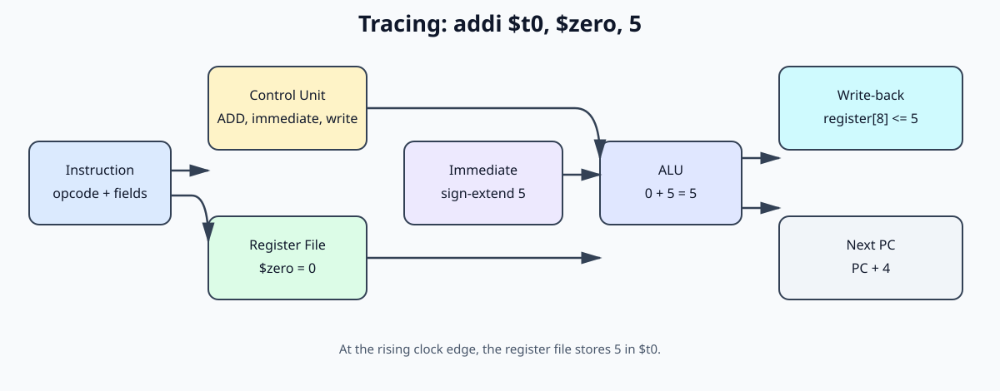

# Beginner Roadmap: From Verilog to a CPU

This guide is for readers who can read small Verilog modules such as
`rtl/alu.v`, but have not yet studied CPU architecture. You do not need to
know MIPS, RISC-V, assembly language, or operating systems before starting.

The repository is arranged so that a beginner can learn one idea at a time.
Do not begin by trying to understand every wire in `mips32_cpu.v`. A CPU is
just a group of familiar digital circuits connected by a carefully defined
instruction format.

## The mental model

At the highest level, a CPU repeatedly answers two questions:

1. **What instruction is stored at the current PC?**
2. **What state should change when that instruction finishes?**

The program counter identifies the current instruction. The instruction tells
the processor which registers to read, which operation to perform, whether
memory is involved, and where execution goes next.

```text
current PC
    ↓
fetch instruction
    ↓
decode instruction
    ↓
read registers and form immediate
    ↓
execute ALU operation
    ↓
optional memory access
    ↓
write result and choose next PC
```

In this project, all of those steps happen during one clock period. The
resulting state is captured at the rising edge.



<p align="center">
  <small><em><strong>Figure 1.</strong> Single-cycle instruction flow from fetch through write-back.</em></small>
</p>

The arrows form a loop because the completed instruction produces the next
PC, and that next PC begins the following instruction.

## How the repository maps to the picture



<p align="center">
  <small><em><strong>Figure 2.</strong> Organization of the MIPS32 processor and its primary modules.</em></small>
</p>

The large boxes in this picture are not abstract textbook names. They are
the modules in `rtl/`. The top-level `mips32_cpu.v` instantiates and wires
them together.

## Before opening the CPU files

You should be comfortable with these Verilog ideas:

| Idea | Where it appears |
| --- | --- |
| `wire` and continuous `assign` | `alu.v`, `datapath.v` |
| `reg` outputs driven by `always` | `alu.v`, memories |
| `always @(*)` combinational logic | ALU and control unit |
| `always @(posedge clk)` sequential logic | PC, register file, data memory |
| non-blocking assignment (`<=`) | clocked state updates |
| arrays of words | register file and memories |
| testbench clocks and `$display` | every `tb/*_tb.v` file |

If these are unfamiliar, read the relevant unit test before reading the
complete CPU. A testbench is an executable explanation of a module's contract.

## Lesson 1: Bits, numbers, and addresses

Hardware does not see names such as `add $t0, $t1, $t2`. It sees bits. A
32-bit instruction is a pattern of zeros and ones divided into fields.

You will use three number representations:

- **Binary** shows individual wires and fields.
- **Hexadecimal** groups four bits into one digit, making 32-bit values easier
  to read.
- **Decimal** is convenient when discussing register values or offsets.

For example:

```text
5 decimal  = 0000...0101 binary = 0x00000005
```

An instruction address is a byte address. Since every instruction is four
bytes, normal execution advances from `PC` to `PC + 4`, not `PC + 1`.

**Repository connection:** inspect `rtl/pc.v` and
`rtl/instruction_memory.v`. The instruction memory removes the low two
address bits when selecting a word, and rejects unaligned addresses.

## Lesson 2: State and time

Combinational logic calculates a result from current inputs. Sequential logic
remembers a result until a later clock edge.

```text
combinational: output = function(inputs)
sequential:    state_next is captured on posedge clk
```

The ALU is combinational. If its inputs change, its output changes without
waiting for a clock. The PC is sequential. It changes only at a rising edge.

**Repository connection:** compare `rtl/alu.v` with `rtl/pc.v`. This contrast
is the foundation of the entire processor.

## Lesson 3: Registers are the CPU's fast working area

The register file contains 32 registers, each 32 bits wide. Instructions
refer to registers by five-bit numbers:

```text
2^5 = 32 registers
```

This design can read two registers at the same time and write one register at
the clock edge. Register 0 is special: `$zero` always reads as zero and
cannot be changed.

**Repository connection:** read `rtl/register_file.v`, then run
`tb/register_file_tb.v`. Pay special attention to the difference between
asynchronous reads and synchronous writes.

## Lesson 4: Instructions are data structures

An instruction is a 32-bit record. The first six bits are usually the
opcode. The remaining fields depend on the instruction format:

```text
R-type: opcode | rs | rt | rd | shamt | funct
I-type: opcode | rs | rt | immediate
J-type: opcode | target
```

For example, `addi` needs a source register, a destination register, and a
constant. `add` needs two source registers and a destination register.

**Repository connection:** compare the bit slices used in
`rtl/control_unit.v` and `rtl/datapath.v` with the instruction tables in
[`instruction-set.md`](instruction-set.md).

## Lesson 5: The control unit is the instruction interpreter

The control unit does not calculate the answer itself. It tells the datapath
what kind of answer to calculate.

For `add`, it says approximately:

```text
read rs and rt
use a register as ALU input B
perform addition
write the ALU result to rd
do not access data memory
advance to PC + 4
```

For `lw`, it says:

```text
sign-extend the offset
add base register and offset
read data memory
write memory data to rt
```

**Repository connection:** read the default assignments at the beginning of
the combinational block in `rtl/control_unit.v`. They make unsupported
instructions harmless.

## Lesson 6: Follow one `addi` instruction

Use the program instruction `addi $t0, $zero, 5`.

### Fetch

The PC points to an instruction-memory word. Instruction memory returns the
32-bit encoding.

### Decode

The opcode identifies `addi`. The fields identify `$zero` as the source and
`$t0` as the destination. The immediate is 5.

### Operand preparation

The register file reads `$zero`, producing 0. The immediate is sign-extended
to 32 bits:

```text
5 -> 0x00000005
```

### Execute

The ALU receives 0 and 5 and adds them:

```text
0 + 5 = 5
```

### Write-back

The register file writes 5 into register 8 at the rising edge. The next PC is
`PC + 4`.

This is the smallest useful complete CPU story: instruction bits become
control signals, control signals move data, and a clock edge saves the result.



<p align="center">
  <small><em><strong>Figure 3.</strong> Datapath trace for the `addi $t0, $zero, 5` instruction.</em></small>
</p>

## Lesson 7: Follow `lw` and `sw`

Memory instructions introduce an address calculation:

```text
effective address = base register + sign-extended offset
```

For `sw`, the ALU calculates the address and the `rt` value is written to
data memory at the clock edge.

For `lw`, data memory returns the word at that address and the register file
captures it at the clock edge.

The same ALU is therefore used both for arithmetic and for memory addresses.
The control signal `alu_src` selects whether its second input is a register or
an immediate.

## Lesson 8: Follow a branch

`beq rs, rt, offset` first subtracts the two registers. If the result is zero,
the branch is taken:

```text
branch target = PC + 4 + (sign_extended_offset << 2)
```

The shift by two converts an instruction offset into a byte offset. `bne`
uses the same subtraction but takes the branch when the result is not zero.

**Repository connection:** inspect `branch_ne` in `control_unit.v` and
`branch_taken` in `datapath.v`.

## Lesson 9: Follow a jump and a function call

`j` replaces the normal next PC with a constructed jump address.

`jal` does two things:

1. writes `PC + 4` into register 31, `$ra`;
2. jumps to the target.

Later, `jr $ra` reads register 31 and loads it into the PC path. This is the
basic mechanism for returning from a function.

## Recommended file order

Read and run the repository in this order:

1. `rtl/alu.v` and `tb/alu_tb.v`
2. `rtl/pc.v` and `tb/pc_tb.v`
3. `rtl/register_file.v` and `tb/register_file_tb.v`
4. `rtl/instruction_memory.v` and `tb/instruction_memory_tb.v`
5. `rtl/control_unit.v` and `tb/control_unit_tb.v`
6. `rtl/data_memory.v` and `tb/data_memory_tb.v`
7. `rtl/datapath.v` and `tb/datapath_tb.v`
8. `rtl/mips32_cpu.v` and `tb/mips32_cpu_tb.v`

At every stage, ask:

- What are the inputs?
- Which outputs are combinational?
- Which values are remembered?
- What changes at the clock edge?
- What test would fail if this signal were wrong?

## Exercises for first-time CPU learners

1. Change an `addi` immediate and predict the register result before running
   the simulation.
2. Add a negative immediate and observe sign extension.
3. Change an `add` instruction to `sub` and predict the ALU output.
4. Use an unaligned data address and observe the safe behavior.
5. Change a `beq` into a `bne` and predict the PC.
6. Add a display of `pc`, `instruction`, `alu_result`, and `next_pc` to the
   integration testbench.
7. Add one new ALU instruction and follow it through control, datapath, test,
   and documentation.

## What comes after this roadmap?

Once this single-cycle processor is comfortable, study:

- assembly language and assemblers;
- RISC-V as a related but different ISA;
- pipelining and hazards;
- forwarding and stalls;
- caches and memory hierarchies;
- exceptions and interrupts;
- synthesis and FPGA implementation.

Those topics build on the same core ideas. They should come after the reader
can trace one instruction through this repository without guessing.
